# Servlet releases

This is Servlet's public distribution repository for macOS, Windows and Linux. Application development remains in the private `hgoudat/servlet-desktop` repository. Only reviewed app bundles and installer files are released here.

Downloads are being prepared. Windows downloads are withheld until Microsoft Artifact Signing finishes organization verification and its signing step is configured. No unsigned Windows preview is published.

## Release bridge

```mermaid
flowchart LR
  A[Private source version tag] --> B[Private Mac, Windows and Linux builds]
  B --> C[Native and installed-package checks]
  C --> D[Private compiled artifacts]
  D -->|Actions read-only access| E[Public distribution workflow]
  E --> F[Owner release approval]
  F --> G[Apple signing and notarization]
  G --> H[Immutable GitHub release]
  H --> I[Verify public downloads]
  I --> J[Promote app update feed]
```

The private workflow builds on each target OS, tests native terminals and installed packages, and uploads only a bundle manifest and compiled files. Branch/PR validation artifacts are explicitly ineligible for release. Successful tagged runs carry the version, source commit, workflow run and file checksums.

The public workflow discovers eligible private runs every 15 minutes, or accepts a run ID manually. It checks repository ID, workflow path, success status, native validation, version, architecture and file hashes. It does not check out the private source or execute private build scripts. The public `servlet-release` environment requires owner approval before signing.

The Mac app is signed with Developer ID, notarized, stapled and assessed. Linux .deb and AppImage files are released only after native/installation checks. Windows installers remain private. All artifacts are assembled into a draft GitHub release, then published with release immutability enabled. The workflow verifies public file downloads before updating the `feeds` branch's `release.json` with a conditional write.

The Mac app checks that feed when it opens and every six hours. Its notice opens update Settings, where downloading and restarting are separate reviewed actions. Native updates require an installed Developer ID signed baseline. A failed partial publication can recover the original immutable release metadata and retry pointer promotion without rebuilding its assets.

## GitHub Free setup

Public standard GitHub-hosted runners, protected branches, and environment reviewers are available on GitHub Free. Private builds consume the account's included private Actions allowance. This bridge requires no GitHub Pro subscription and no Supabase or Vercel publishing credential.

Keep public `main` protected, require the distribution validation status check, and restrict the `servlet-release` environment to `main` with owner approval. Release workflows reject manual runs from other branches. Do not configure signing credentials until these protections and the reviewed distribution workflow are in place.

Configure `PRIVATE_ARTIFACT_READ_TOKEN` as a repository secret. Use a fine-grained token limited to **only** `hgoudat/servlet-desktop`, with **Actions: Read-only** and the automatic Metadata read permission. It requires no Contents, Administration or workflow write access. Enter it privately in GitHub; do not paste it into chat. Its purpose is to read private build metadata and compiled installer artifacts.

Configure these secrets in the public `servlet-release` environment:

| Secret | Purpose |
| --- | --- |
| `APPLE_CERTIFICATE_BASE64` | Base64 PKCS#12 of the Developer ID Application certificate and private key |
| `APPLE_CERTIFICATE_PASSWORD` | PKCS#12 export password |
| `APPLE_APP_SPECIFIC_PASSWORD` | Apple notarization credential |

Set environment variables `APPLE_TEAM_ID=8V3C66NC5Z`, `APPLE_SIGNING_IDENTITY=Developer ID Application: Hameed Goudat (8V3C66NC5Z)`, and `APPLE_ID` to the Apple ID used for notarization. Signing material is imported into an ephemeral Keychain and removed even when a release fails. Signing keys and private staging are never uploaded as CI artifacts.

Set repository variable `RELEASE_BRIDGE_ENABLED=true` only after setup. It starts as false. Merge the private build/updater changes, create a matching `v<package-version>` tag on private main, wait for all builds to pass, and approve the resulting public release job. The private source repository remains private throughout.

The mutable latest pointer is public at `https://raw.githubusercontent.com/hgoudat/servlet-releases/feeds/release.json`. Per-version installers, the Squirrel feed and checksum files are immutable GitHub release attachments. The existing download website can proxy the pointer through its `/release.json` route.
